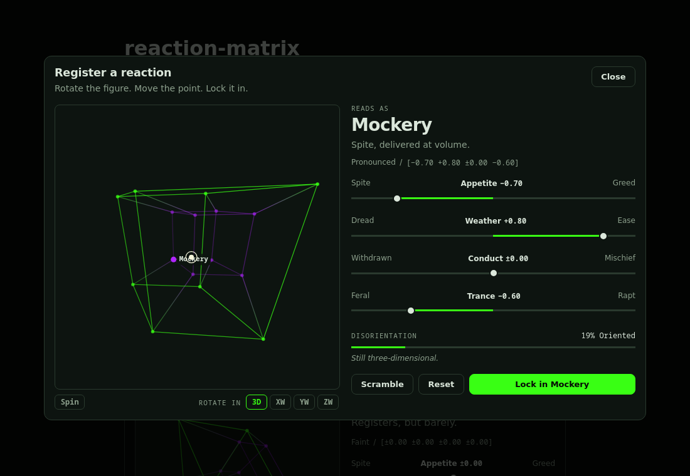

# reaction-matrix

A hypercube of reactions. One drop-in React button opens a draggable four-dimensional figure; the
person rotates it, moves a point through four axes, and locks in a vector. It is meant to replace
upvotes and emoji reactions with something that records *how* a thing landed, not just that it did.

<p align="center">
  
</p>

```tsx
import { ReactionMatrixButton } from '@goblinlife/reaction-matrix';
import '@goblinlife/reaction-matrix/styles.css';

<ReactionMatrixButton
  targetId="post-123"
  summary={summary}   // everyone's reactions so far
  mine={mine}         // this person's locked reaction, if any
  onReact={save}      // called when they lock in
/>
```

- **One component, no dependencies** beyond React 19. Plain CSS, no Tailwind or CSS-in-JS.
- **You own the data.** The component takes a summary and a callback; it never fetches or stores
  anything. A framework-free `math` module validates and aggregates reactions on your server.
- **Accessible.** Native `<dialog>` (focus trap, Escape), keyboard rotation, labelled meters and
  sliders, `prefers-reduced-motion` respected.
- **Themeable** with a dozen CSS custom properties.

## Contents

[Install](#install) · [Quick start](#quick-start) · [How it works](#how-it-works) ·
[Components](#components) · [Storing reactions](#storing-reactions) · [Theming](#theming) ·
[Math API](#math-api) · [Development](#development) · [License](#license)

## Install

The package is not on npm. Use it from git, as a submodule, or by copying `src/`.

```bash
# as a git submodule (what GoblinLife does; works with pnpm/npm/yarn workspaces)
git submodule add https://github.com/C-Vac/reaction-matrix packages/reaction-matrix

# or straight from GitHub
npm install github:C-Vac/reaction-matrix
```

It is shipped as TypeScript source (`main` is `src/index.ts`), so your bundler must compile
dependencies. In Next.js add it to `transpilePackages`:

```js
// next.config.mjs
export default { transpilePackages: ['@goblinlife/reaction-matrix'] };
```

Vite, webpack and esbuild handle TypeScript in `node_modules` out of the box.

Requires **React 19**. Browsers: anything with `<dialog>.showModal()` and `<canvas>` (all current
evergreen browsers).

## Quick start

```tsx
import { useState } from 'react';
import { ReactionMatrixButton } from '@goblinlife/reaction-matrix';
import { EMPTY_SUMMARY, applyReaction, type ReactionDraft } from '@goblinlife/reaction-matrix/math';
import '@goblinlife/reaction-matrix/styles.css'; // import once, anywhere in your app

export function Post({ id, title }: { id: string; title: string }) {
  const [summary, setSummary] = useState(EMPTY_SUMMARY);
  const [mine, setMine] = useState<ReactionDraft | null>(null);

  return (
    <ReactionMatrixButton
      targetId={id}
      targetLabel={title}
      summary={summary}
      mine={mine}
      onReact={(draft) => {
        setSummary(applyReaction(summary, draft, mine)); // `mine` is swapped out, not double counted
        setMine(draft);
      }}
    />
  );
}
```

A runnable version lives in [`demo/`](demo): `cd demo && npm install && npm run dev`.

In the Next.js App Router the components are client components (they carry `"use client"`), so
you can render them from server components without a wrapper.

## How it works

A reaction is a point in a 4D unit hypercube. There are four axes, each running from -1 to +1
between two poles:

| Axis | -1 | +1 |
|---|---|---|
| **x** Appetite | Spite | Greed |
| **y** Weather | Dread | Ease |
| **z** Conduct | Withdrawn | Mischief |
| **w** Trance | Feral | Rapt |

The 16 corners of the hypercube are the 16 named reactions. A point between corners reads as its
nearest corner, with an *intensity* (Faint, Moderate, Pronounced, Total) from its distance to the
origin. Close to the origin it reads **Unmoved**, which is a real answer rather than a blank.

| x y z w | Reaction | | x y z w | Reaction |
|---|---|---|---|---|
| + + + + | Rapture | | + + + - | Frenzy |
| - + + + | Schadenfreude | | - + + - | Mockery |
| + - + + | Avarice | | + - + - | Panic |
| - - + + | Malice | | - - + - | Rage |
| + + - + | Smugness | | + + - - | Possessiveness |
| - + - + | Grudge | | - + - - | Contempt |
| + - - + | Longing | | + - - - | Paranoia |
| - - - + | Vertigo | | - - - - | Numbness |

The figure is a tesseract projected from 4D to 3D along **w**, then to the screen along **z**.
Dragging rotates it in the ordinary planes; choosing **XW**, **YW** or **ZW** rotates it through
the fourth dimension, which is where most people get lost. Clicking a corner snaps the point to it.

Every dialog also reports a **disorientation** score (0 to 100) built from how much the person
tumbled the figure, how many times they adjusted an axis, and how long they took. It is returned
with the reaction so you can use it, or ignore it.

## Components

All exports are typed. Props below are the public contract.

### `ReactionMatrixButton`

The trigger button plus a modal dialog containing the panel.

| Prop | Type | Description |
|---|---|---|
| `targetId` | `string` | What is being reacted to. Used in the accessible name. |
| `targetLabel` | `string?` | Human-readable name for the target; preferred over `targetId` in the accessible name. |
| `summary` | `ReactionSummary?` | Everyone's reactions. Drives the count, the consensus label and the "Everyone else" read-out. |
| `mine` | `ReactionDraft \| null?` | The current person's locked reaction. The button shows it and the dialog opens in revise mode. |
| `onReact` | `(draft) => void \| Promise<void>` | Called on lock-in. Resolve to close the dialog; throw or reject to show an error and keep it open. |
| `onBeforeOpen` | `() => boolean \| void` | Return `false` to stop the dialog opening, e.g. to ask the person to sign in first. |
| `size` | `'sm' \| 'md'` | Button size. Default `md`. |
| `label` | `string` | Text shown before anyone has reacted. Default `React`. |
| `className` | `string` | Added to the wrapper element. |

The button reads **React** when empty, the group's consensus reaction (the nearest corner to the
mean vector) once there are reactions, and the person's own reaction after they lock in.

### `ReactionMatrixPanel`

The picker without the button or dialog, for embedding inline.

| Prop | Type | Description |
|---|---|---|
| `onLock` | `(draft) => void \| Promise<void>` | Required. Called with the locked reaction. |
| `initialVector` | `Vector4D \| null?` | Where the point starts. Pass the person's previous vector to revise. Default: the origin. |
| `summary` | `ReactionSummary?` | Shows the collapsed "Everyone else" read-out when it has reactions. |
| `revising` | `boolean?` | Changes the button wording to "Revise". |
| `onCancel` | `() => void` | Adds a Cancel button. |

### `TesseractCanvas`

Just the rotatable figure, if you want to build your own form around it.

| Prop | Type | Description |
|---|---|---|
| `value` | `Vector4D` | The point to draw. The component never changes it. |
| `onPickCorner` | `(corner: Archetype) => void` | A corner was clicked or tapped. |
| `onTumble` | `(radians: number) => void` | Size of each user-driven rotation, for your own disorientation measure. |

### The reaction types

```ts
interface ReactionDraft {        // what onReact / onLock give you
  vector: { x: number; y: number; z: number; w: number }; // each -1..1
  archetypeId: string;           // e.g. "contempt", or "unmoved"
  disorientation: number;        // 0..100
}

interface ReactionSummary {      // what you pass back in
  count: number;
  sum: Vector4D;                 // running totals, not means
  archetypeCounts: Record<string, number>;
}
```

Summaries hold sums rather than means so a reaction can be added, replaced or removed in O(1)
without reading every vote. Use `meanVector(summary)` when you need the average.

## Storing reactions

Persistence is yours. The recommended shape is **one reaction per person per target, revisable**:
keep each person's current draft, and keep one `ReactionSummary` per target. The `math` module is
pure TypeScript with no React or DOM, so a server can use exactly the code the client does:

```ts
import { EMPTY_SUMMARY, applyReaction, sanitizeDraft } from '@goblinlife/reaction-matrix/math';

// POST /reactions  { targetId, vector, disorientation }
const draft = sanitizeDraft(body);          // null if malformed
if (!draft) return res.status(400).end();

await db.transaction(async (tx) => {
  const prev = await tx.getVote(userId, targetId);        // that person's earlier draft, or null
  const summary = (await tx.getSummary(targetId)) ?? EMPTY_SUMMARY;
  tx.setSummary(targetId, applyReaction(summary, draft, prev)); // replaces prev instead of adding
  tx.setVote(userId, targetId, draft);
});
```

Notes:

- **Never trust the client's `archetypeId`.** `sanitizeDraft` ignores it and recomputes it from
  the vector. It also clamps coordinates to -1..1, rounds them to 0.01, and clamps
  `disorientation` to 0..100.
- **Do the swap in a transaction** so two revisions cannot both subtract the same old vote.
- **Store votes per person, not in an array on the target.** A popular target would otherwise hit
  document-size limits in most databases.
- **Require sign-in** if you want one reaction per person: anonymous visitors have no stable
  identity. `onBeforeOpen` is the place to prompt.

## Theming

The stylesheet is plain CSS with BEM-ish `rm-` class names. Theme it by setting these custom
properties anywhere above the component (usually `:root`). Every one has a fallback, so none are
required.

| Property | Used for |
|---|---|
| `--rm-surface` | Dialog and trigger background, canvas label backing |
| `--rm-line` | Hairlines, slider tracks, button borders |
| `--rm-ink` | Main text, slider thumbs |
| `--rm-muted` | Secondary text |
| `--rm-rapt` | The positive-**w** half of the figure; primary accent; focus ring |
| `--rm-feral` | The negative-**w** half of the figure; "Everyone else" bars |
| `--rm-point` | The reaction point |
| `--rm-on-accent` | Text on the filled primary button |
| `--rm-font`, `--rm-font-display`, `--rm-font-mono` | Body, headings, numbers and canvas labels |

The canvas re-reads the colors and font from these properties periodically, so changing a
theme (including light/dark) takes effect without remounting. The dialog is a `<dialog>`, which
renders in the browser's top layer, so it is not clipped by `overflow` or `z-index` on its parents.

## Math API

`@goblinlife/reaction-matrix/math` exports (all pure):

| Group | Exports |
|---|---|
| Vocabulary | `AXES`, `ARCHETYPES`, `UNMOVED`, `archetypeById`, `nearestCorner`, `CORNER_AT_VERTEX`, `readVector` |
| Reactions | `ReactionDraft`, `ReactionRecord`, `sanitizeDraft` |
| Aggregation | `ReactionSummary`, `EMPTY_SUMMARY`, `applyReaction`, `meanVector`, `topArchetypes` |
| Disorientation | `measureDisorientation` |
| Geometry | `VERTICES`, `EDGES`, `rotate`, `project`, `vertexIndexOf`, `clampVector`, `distance4D`, `ORIGIN`, `NO_ROTATION` |

`readVector(v)` returns `{ archetype, intensity, intensityLabel, dominantAxis }` for any point.

## Development

```bash
npm install
npm test        # vitest: geometry, vocabulary, aggregation, validation
npm run lint    # tsc --noEmit
npm run demo    # needs `npm install` inside demo/ first
```

The library lives in `src/`:

| File | What |
|---|---|
| `math.ts` | Vocabulary, geometry, aggregation, validation. No React, no DOM. |
| `TesseractCanvas.tsx` | The canvas figure and its pointer / keyboard handling. |
| `ReactionMatrixPanel.tsx` | Figure + reading + sliders + lock-in. |
| `ReactionMatrixButton.tsx` | Trigger button + `<dialog>`. |
| `styles.css` | All styling and the `--rm-*` hooks. |

## Origin

This began as a Google AI Studio prototype for the prompt *"a hypercube of emotions allowing
humans to interactively move the tesseract around and select an emotion to react to content,
replaces social features such as upvote and reaction emojis"*, then was rebuilt as a library for
[GoblinLife](https://goblinlife.org), where it replaces upvotes sitewide.

## License

[Apache-2.0](LICENSE)
